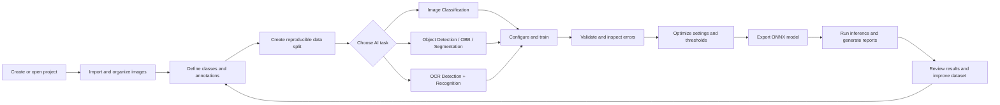
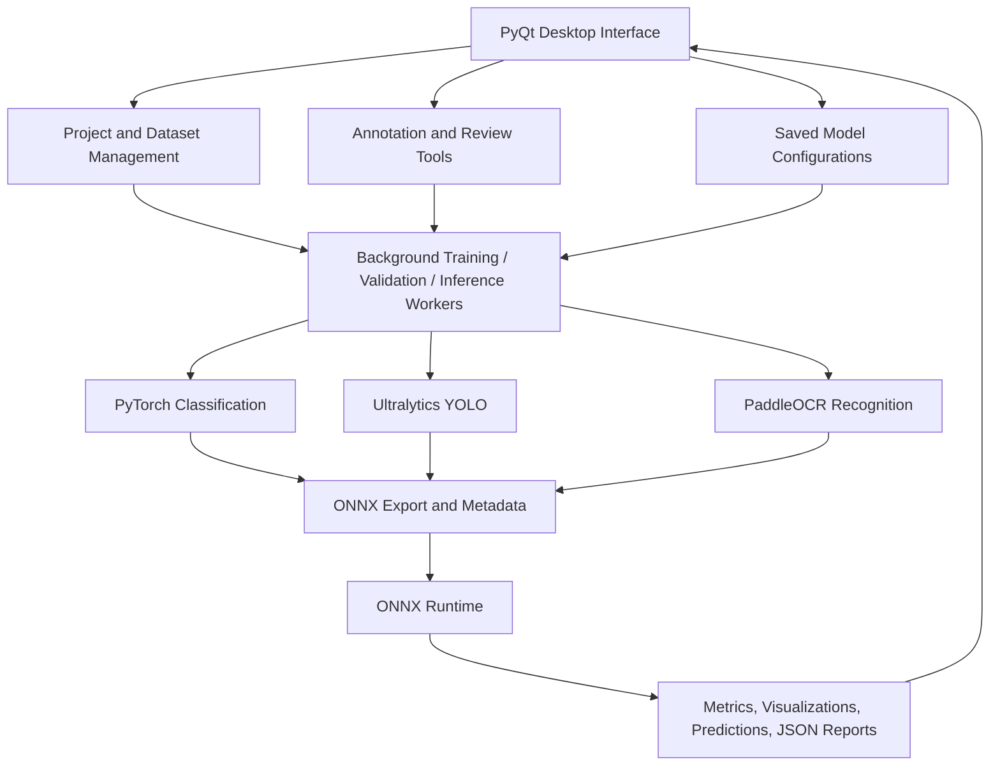

# SYSCONA AI Studio

### An end-to-end desktop AI suite for building, training, validating, and deploying computer-vision models

> [!IMPORTANT]
> This is a public product-overview repository. The source code, application binaries, trained model weights, datasets, and internal technical assets are proprietary and are intentionally not included.

## Contents

- [Overview](#overview)
- [Why SYSCONA AI Studio?](#why-syscona-ai-studio)
- [Application Suite](#application-suite)
- [Features](#features)
- [End-to-End Workflow](#end-to-end-workflow)
- [Module Details](#module-details)
- [Engineering Tasks Completed](#engineering-tasks-completed)
- [Architecture](#architecture)
- [Technology Stack](#technology-stack)
- [Setup](#setup)
- [Usage](#usage)
- [Results and Validation](#results-and-validation)
- [Limitations](#limitations)
- [Generated Outputs](#generated-outputs)
- [Privacy, Confidentiality, and Availability](#privacy-confidentiality-and-availability)
- [Project Status](#project-status)

## Overview

**SYSCONA AI Studio** is a Windows desktop suite that brings the complete computer-vision lifecycle into a visual, no-code/low-code workspace. It enables users to organize image datasets, create annotations, prepare reproducible data splits, train deep-learning models, inspect results, optimize runtime behavior, export portable ONNX models, and run inference without having to assemble separate scripts and tools.

The studio combines three focused AI applications under one product family:

1. **Image Classification** — trains models that assign one class to an image.
2. **Object Detection and Segmentation** — locates and classifies one or more objects in an image.
3. **Optical Character Recognition (OCR)** — detects text regions and recognizes their character sequences.

The product is designed for practical computer-vision development, repeatable experimentation, local model execution, and review of real predictions—not only headline metrics.

## Why SYSCONA AI Studio?

Computer-vision projects usually require several disconnected tools for dataset management, annotation, training, validation, model conversion, and testing. SYSCONA AI Studio connects those stages in one consistent desktop workflow.

Key goals of the platform include:

- Reducing the amount of custom scripting required to build vision models.
- Keeping project data, experiment settings, and generated artifacts organized.
- Making experiments repeatable through saved splits, seeds, and tool configurations.
- Supporting both CPU and NVIDIA GPU execution profiles.
- Providing visual validation and explainability instead of relying only on aggregate scores.
- Producing portable ONNX models for efficient downstream inference.
- Allowing sensitive image data to be processed within a controlled local environment.

## Application Suite

| Module | Primary purpose | Main model families | Key results |
| --- | --- | --- | --- |
| **Image Classification** | Assign a category to a complete image | ResNet-18, ResNet-34, ResNet-50, ResNet-101 | Class prediction, confidence, confusion matrix, Grad-CAM, ONNX model |
| **Object Detection** | Find and classify multiple objects | YOLO Detect, YOLO Oriented Bounding Box, YOLO Segment | Boxes, rotated boxes, masks/polygons, confidence, precision, recall, F1, mAP, ONNX model |
| **OCR** | Locate text and convert it into character sequences | YOLO detection models and PaddleOCR recognition models | Text regions, recognized text, detection/recognition confidence, exact accuracy, edit score, ONNX models |

## Features

### 1. Project and Experiment Management

- Create, open, rename, copy, and archive independent AI projects.
- Keep datasets, labels, splits, configurations, checkpoints, validation summaries, and inference results together.
- Save multiple model configurations as reusable **tools** for side-by-side experimentation.
- Preserve important parameters such as architecture, image size, batch size, epochs, device, seed, split, and threshold policy.
- Use clear operation states and confirmation dialogs to reduce accidental destructive actions.

### 2. Dataset Curation

- Import individual images or complete image collections.
- Create, rename, import, export, and delete class definitions.
- Search, filter, sort, preview, relabel, move, rename, and remove images.
- Track unlabeled, partially labeled, fully labeled, training, validation, and test data.
- Inspect file metadata, image dimensions, labels, object counts, and prediction details.
- Export curated datasets for controlled backup or transfer.

Common supported image formats include PNG, JPEG, BMP, TIFF, and WebP.

### 3. Annotation

The detection and OCR modules provide an interactive annotation canvas with multiple region-of-interest tools:

- Axis-aligned rectangle
- Rotated rectangle
- Parallelogram
- Polygon
- Ellipse
- Curved box

Users can move, resize, copy, paste, edit, reclassify, or delete annotations. A single internal annotation can be transformed into the format required for standard detection, oriented-box detection, or segmentation training.

OCR projects also support:

- Ground-truth text attached to individual objects.
- Separate partially labeled and fully labeled states.
- OCR-generated review proposals that remain separate from training labels until accepted.
- Editing and confirming recognized text before it becomes ground truth.
- Re-running recognition on a selected region.

### 4. Reproducible Dataset Splitting

- Create named train, validation, and test splits.
- Configure split percentages and deterministic random seeds.
- Preserve split membership for consistent comparisons between experiments.
- Review image counts and class/object distributions before training.
- Use stratified class-aware splitting in the classification workflow.
- Include confirmed background or no-object images in detection training when appropriate.

### 5. Data Augmentation

The classification workflow includes configurable augmentation recipes such as:

- Rotation, scaling, shifting, and shearing
- Brightness and saturation variation
- Noise injection
- Horizontal and vertical flipping
- Class-specific augmentation overrides
- Original/minimum/maximum transformation previews

The detection training pipeline is designed around task-appropriate augmentation concepts including mosaic, translation, scale, rotation, color variation, mixup, and copy-paste. Its user-facing augmentation controls are being expanded. Augmentation is intended to represent realistic production variation rather than generate arbitrary distortions.

### 6. Model Training

- Configure training through the graphical interface.
- Select model family, image size, epochs, batch size, device, workers, patience, and seed.
- Run on CPU, CUDA, or automatic device selection.
- Use early stopping and safe user-requested stopping.
- View live logs and epoch-by-epoch loss curves.
- Show or hide individual loss series while training.
- Retain the best and latest usable checkpoints where supported.
- Export trained models to ONNX as part of the model lifecycle.

Long-running work is executed outside the main interface so that training, validation, and inference do not freeze the desktop application. Detection and recognition workloads are also isolated where necessary to avoid runtime conflicts between deep-learning frameworks.

### 7. Validation and Model Analysis

#### Classification

- Accuracy, precision, recall, and F1 score
- Per-class confusion matrix
- Correct/incorrect prediction filtering
- Confidence-based review
- Grad-CAM visual explanations
- Side-by-side inspection of difficult or misclassified samples

#### Object Detection

- Precision, recall, and F1 score
- mAP at IoU 0.50 and across IoU 0.50–0.95 when available
- Actual-versus-predicted visual overlays
- Global and per-class confidence analysis
- Non-Maximum Suppression (NMS) tuning
- Inspection of false positives, false negatives, duplicate predictions, and localization quality

#### OCR Recognition

- Exact full-string accuracy
- Normalized Levenshtein edit score
- Mean recognition confidence
- Per-class and per-partition summaries
- Crop-level actual-versus-predicted review
- Reusable ONNX Runtime validation sessions for representative runtime testing

### 8. Detection Threshold Optimization

The detection and OCR-detection workflows can evaluate many confidence and NMS combinations after validation.

- **Global mode** applies one confidence threshold to all classes.
- **Per-class mode** allows difficult and high-noise classes to use different thresholds.
- Precision, recall, global F1, and macro F1 update as settings are evaluated.
- Selected threshold behavior is saved with the model configuration.
- Final detection ONNX exports can embed candidate filtering and NMS behavior.

This makes deployment behavior explicit and repeatable instead of depending on undocumented runtime constants.

### 9. ONNX Export and Inference

SYSCONA AI Studio uses ONNX as the portable deployment format for trained models.

Inference supports:

- Testing newly loaded images.
- Testing project images or a selected validation/test split.
- Automatic CPU/CUDA provider selection where supported.
- Per-image confidence and timing information.
- Visual prediction galleries and detailed logs.
- Exporting or returning reviewed predictions to the dataset.
- Structured JSON reports for OCR inference runs.

The OCR application provides three inference modes:

1. **Detection only** — locate regions in complete images.
2. **Recognition only** — recognize text in pre-cropped images.
3. **Complete OCR pipeline** — detect regions, rectify/crop them, recognize text, and return structured per-region results.

## End-to-End Workflow

Typical use follows an iterative model-development loop:

1. Create a project and define the required classes.
2. Import representative images.
3. Label complete images, objects, or text regions.
4. Create a deterministic train/validation/test split.
5. Create a model tool and save its configuration.
6. Train while monitoring loss curves and logs.
7. Validate on data not used for weight updates.
8. Inspect actual predictions and failure cases.
9. Adjust data, configuration, or detection thresholds.
10. Export a finalized ONNX model.
11. Test the model on realistic unseen inputs.
12. Feed reviewed examples back into the next training iteration.

## Module Details

### Image Classification Studio

The classification module is intended for problems where each image belongs to one primary category, such as product identification, part classification, defect category assignment, or visual sorting.

Notable functions include:

- Folder- and class-based dataset organization.
- Deterministic or stratified split generation.
- Saved augmentation presets and class-specific overrides.
- ResNet architecture selection.
- Weighted sampling for imbalanced datasets.
- Live training accuracy/loss monitoring.
- Confusion-matrix-driven error inspection.
- Grad-CAM overlays for model explainability.
- Batch and ad hoc inference.
- ONNX model export and inference dashboards.

### Object Detection Studio

The object-detection module is intended for problems where one image may contain multiple items that must be located and classified.

It supports:

- Standard axis-aligned object detection.
- Oriented bounding boxes for rotated objects, labels, and parts.
- Instance segmentation for irregular or precise object shapes.
- Multiple objects and classes per image.
- Explicit no-object/background samples.
- Train/validation/test split auditing.
- Live YOLO loss monitoring.
- Visual validation overlays.
- Global and class-specific threshold optimization.
- Final ONNX inference-model generation.

### OCR Studio

The OCR module combines text localization and text recognition in a single project workflow. It is suitable for serial numbers, labels, product identifiers, date codes, packaging text, industrial markings, and other structured visual text.

It includes:

- Proposal-assisted labeling using PaddleOCR text models.
- User review before OCR proposals become training data.
- Separate detection and recognition model tools.
- Fine-tuning or direct export of supported pretrained recognizers.
- Recognition crop generation from saved image regions.
- Perspective rectification for rotated four-point regions.
- Exact-match and edit-distance-based recognition validation.
- Detection-only, recognition-only, and combined inference.
- Embedded inference metadata for portable model execution.
- Per-image and per-stage timing reports.

Supported recognition choices include compact, balanced, and higher-capacity PaddleOCR model variants so users can compare accuracy, speed, and resource requirements for their own data.

## Engineering Tasks Completed

The development of SYSCONA AI Studio covers the following product and engineering areas:

| Area | Work performed |
| --- | --- |
| **Desktop UX** | Designed a multi-panel PyQt interface with project controls, contextual sidebars, image galleries, annotation canvases, dashboards, logs, plots, filters, and reusable dialogs. |
| **Project system** | Implemented independent project workspaces, safe project copying/renaming, structured configuration storage, and artifact lifecycle management. |
| **Dataset tooling** | Built image import/export, filtering, class management, annotation state tracking, bulk operations, deterministic splitting, and dataset integrity checks. |
| **Annotation tooling** | Implemented editable geometric ROI types, object tables, copy/paste, class assignment, text ground truth, no-object labeling, and proposal review. |
| **Training integration** | Integrated PyTorch/torchvision classification, Ultralytics YOLO training, and PaddleOCR recognition workflows with configurable hyperparameters. |
| **Experiment tracking** | Saved model recipes, seeds, splits, augmentations, descriptions, checkpoints, loss histories, statuses, and validation summaries per tool. |
| **Validation** | Implemented classification metrics, confusion matrices, Grad-CAM, detection matching metrics, OCR edit metrics, overlays, and failure-case filtering. |
| **Threshold tuning** | Built global/per-class confidence and NMS search, metric comparison, interactive adjustment, persistence, and export behavior. |
| **Model deployment** | Added ONNX conversion, metadata packaging, runtime session management, CPU/GPU provider selection, and portable inference paths. |
| **Performance** | Added background workers, process isolation, warm-up runs, staged timing, batch-one runtime paths, caching, and graceful stop handling. |
| **Reporting** | Produced visual result galleries, logs, validation summaries, model dashboards, prediction artifacts, and structured inference reports. |
| **Distribution** | Created self-contained Windows CPU/GPU application profiles and installer workflows for use without a separately managed Python environment. |
| **Quality assurance** | Added runtime checks, export verification, inference tests, compatibility checks, and built-in user documentation. |

## Architecture

The diagram intentionally shows only the public, high-level design. Internal implementation details are confidential.

## Technology Stack

| Category | Technologies |
| --- | --- |
| **Language** | Python |
| **Desktop interface** | PyQt5, Qt stylesheets |
| **Classification** | PyTorch, torchvision |
| **Detection and segmentation** | Ultralytics YOLO |
| **OCR** | PaddleOCR, PaddlePaddle |
| **Portable model format** | ONNX |
| **Inference runtime** | ONNX Runtime CPU/CUDA |
| **Image processing** | OpenCV, Pillow |
| **Metrics and numerical work** | NumPy and supporting ML utilities |
| **Plots and visualization** | Matplotlib, custom Qt visualization components |
| **Windows distribution** | PyInstaller and Inno Setup |

## Setup

SYSCONA AI Studio is proprietary software. Source code, build scripts, installers, private model artifacts, and internal deployment instructions are intentionally not included in this public repository.

Authorized users receive the appropriate self-contained Windows installer for their approved execution profile:

- **CPU edition** for broad Windows compatibility
- **GPU edition** for supported NVIDIA CUDA environments

The packaged application uses its own managed runtime and does not require users to configure the private development environment. Access is available only through explicit authorization from the project owner.

## Usage

At a high level, users work through the following lifecycle:

1. Create or open an isolated AI project.
2. Import images and define the required classes.
3. Curate classification labels or create object/text-region annotations.
4. Create a deterministic train/validation/test split.
5. Configure a classification, detection, or recognition tool.
6. Train while monitoring logs and loss curves.
7. Validate the exported model and inspect failure cases visually.
8. Optimize detection confidence and NMS behavior where applicable.
9. Export or finalize the ONNX inference model.
10. Run inference on new images or a saved dataset partition.
11. Review predictions, timing information, and generated reports.

Detailed operational instructions are distributed with authorized application builds and are also available through the built-in user manual.

## Results and Validation

The studio provides task-specific evaluation rather than reporting one universal product score:

- **Classification:** accuracy, precision, recall, F1, confusion matrices, confidence review, and Grad-CAM explanations
- **Detection:** precision, recall, F1, mAP where available, actual/predicted overlays, and global or per-class threshold analysis
- **Recognition:** exact string accuracy, normalized edit score, confidence summaries, crop-level review, and runtime timing
- **Inference:** per-image outputs, visual prediction artifacts, provider/device information, staged timing, and structured reports

No customer datasets, benchmark tables, trained weights, or confidential validation artifacts are published in this repository. Model performance depends on the dataset, labeling consistency, model selection, hardware, and evaluation protocol used for a specific project.

## Limitations

- The public repository is documentation-only and cannot be used to build or run the product.
- The current application family targets Windows 10/11 x64 environments.
- GPU execution requires compatible NVIDIA hardware, drivers, and the approved GPU build.
- Some pretrained OCR models can require a one-time download before offline use.
- Benchmarking and additional user-facing augmentation controls remain areas of active development.
- Results are project-specific; the studio cannot compensate for poor data quality, inconsistent annotations, or unrepresentative evaluation sets.
- Deployment into another production system requires separate integration, validation, monitoring, and security work.

## Generated Outputs

Depending on the selected module and workflow, a project can generate:

- Saved dataset and annotation metadata
- Named train/validation/test split definitions
- Reusable augmentation and model configurations
- Training checkpoints and loss histories
- Validation metrics and summaries
- Confusion matrices and explainability overlays
- Detection and OCR prediction visualizations
- Raw validation ONNX models
- Finalized inference ONNX models
- Embedded runtime configuration metadata
- Structured JSON inference reports
- Per-image and aggregate timing statistics

These outputs remain part of the private application workspace and are not included in this repository.

## Example Use Cases

- Industrial part and product classification
- Visual quality inspection and defect categorization
- Object and component localization
- Detection of rotated labels, parts, or text regions
- Segmentation of irregular defects or shapes
- Serial-number and identifier recognition
- Packaging, label, and date-code OCR
- Dataset preparation and annotation review
- Rapid prototyping of custom computer-vision models
- Validation of model behavior before integration into another system

## Privacy, Confidentiality, and Availability

SYSCONA AI Studio is proprietary software. This repository is intentionally limited to product documentation and a high-level technical overview.

The following are **not publicly distributed**:

- Application source code
- Build and packaging scripts
- Installers and executable files
- Proprietary datasets or annotations
- Customer or project data
- Trained checkpoints and model weights
- Internal test assets and implementation documentation

No source-code license is granted through this repository. Access to the application, demonstrations, or additional technical material is available only through explicit authorization.

## Project Status

SYSCONA AI Studio is under active development. The current product family includes working classification, object-detection, and OCR workflows, ONNX model export, local inference, CPU/GPU profiles, and Windows packaging. Continued work focuses on expanded benchmarking, augmentation controls, workflow unification, performance, and deployment flexibility.

## Contact

For product demonstrations, authorized access, collaboration, or business inquiries, please use the contact details on the repository owner's GitHub profile or open an issue in this repository.

## Notice

This repository is provided for product presentation and documentation purposes only. Product names and third-party technologies mentioned here remain the property of their respective owners. Model performance depends on dataset quality, annotation consistency, hardware, configuration, and the conditions under which the model is evaluated.

---

**SYSCONA AI Studio** — from raw images to validated, deployable computer vision.
